<div align="center">

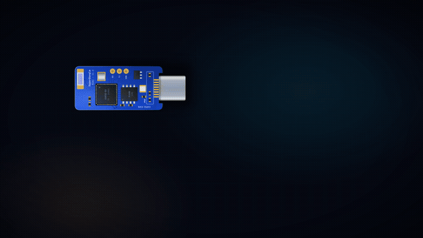

# SuperDongle Mini

**一块 15 × 30 mm 的 ESP32-S3 小板，插在 USB 口上：U 盘、无线文件管理、手机当键鼠、免驱网卡，全部在浏览器里操作。**

<p>


</p>

固件和硬件全部开源 · 个人学习、研究、二次开发随便用，商用请先联系作者授权

[演示视频（B 站）](https://www.bilibili.com/video/BV1e6sk6GEfU/)

[功能](#功能) · [快速上手](#快速上手) · [硬件](#硬件) · [原理图](#原理图) · [固件架构](#固件架构) · [编译烧录](#编译烧录) · [参与共建](#参与共建)

</div>

---

## 目录

- [功能](#功能)
- [快速上手](#快速上手)
- [使用场景](#使用场景)
- [USB 模式](#usb-模式)
- [指示灯](#指示灯)
- [硬件](#硬件)
  - [规格](#规格)
  - [硬件框图](#硬件框图)
  - [原理图](#原理图)
  - [引脚分配](#引脚分配)
  - [PCB](#pcb)
- [固件架构](#固件架构)
  - [目录结构](#目录结构)
  - [Flash 分区与 OTA](#flash-分区与-ota)
- [编译烧录](#编译烧录)
- [常见问题](#常见问题)
- [路线图](#路线图)
- [参与共建](#参与共建)
- [致谢](#致谢)
- [开源协议](#开源协议)

---

## 功能

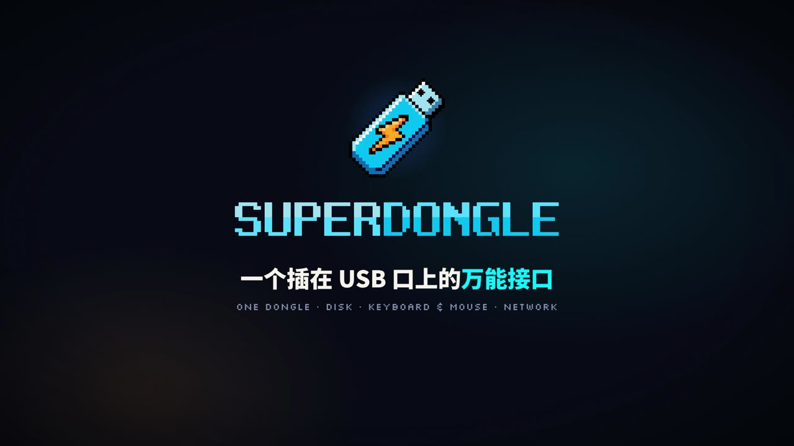

插上电脑，它就是一个 U 盘。连上它的 WiFi，手机浏览器就能管理里面的文件、远程控制电脑、切换工作模式、在线升级固件。不用装 App，也不用装驱动。

<table>
<tr>
<td width="50%">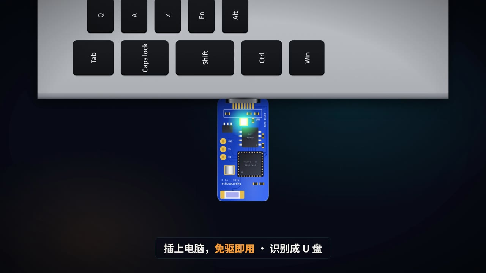<br><b>即插即用</b><br>USB-C 直插，Windows / macOS / Linux 免驱识别为 U 盘，有线读写约 1MB/s。</td>
<td width="50%">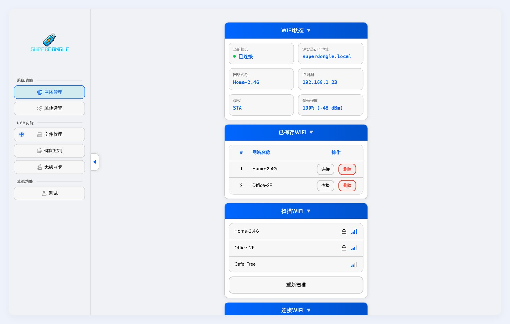<br><b>WiFi 配网</b><br>手机连热点，在「网络管理」页选家里的 WiFi，一步完成。已保存的网络会自动重连。</td>
</tr>
<tr>
<td>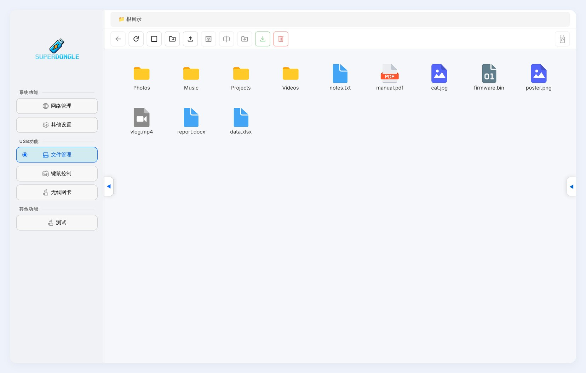<br><b>无线文件管理</b><br>浏览器里上传、下载、重命名、删除 TF 卡上的文件，无线传输最高 4MB/s，支持中文文件名。</td>
<td>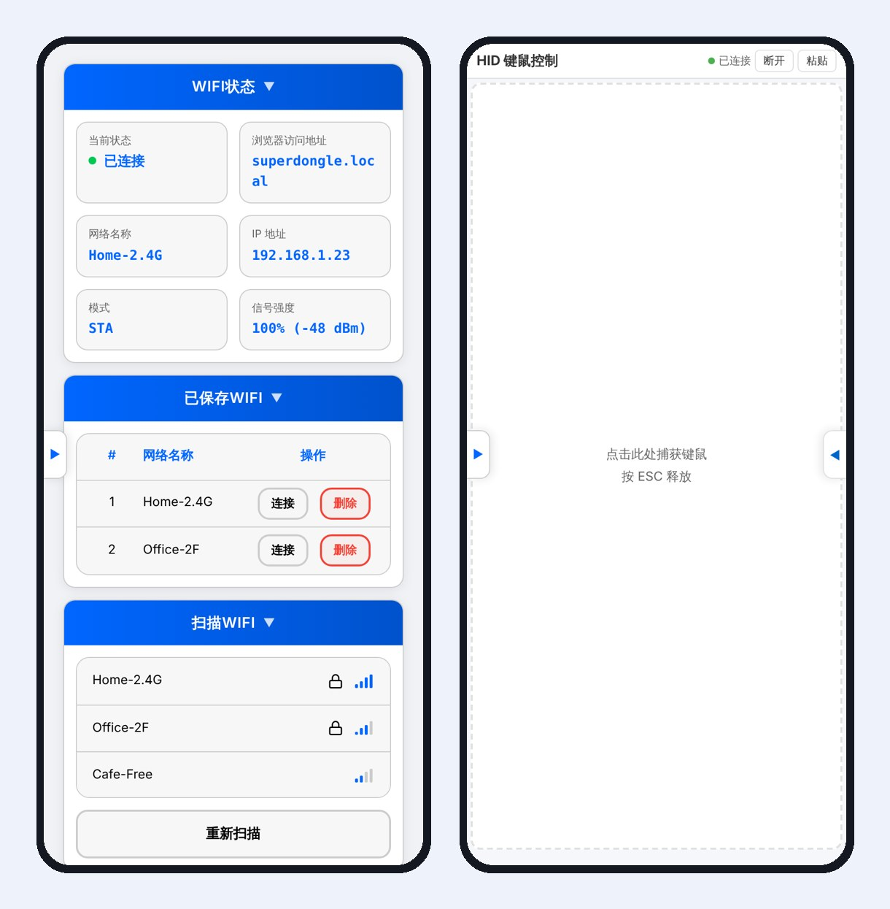<br><b>手机变键鼠</b><br>手机网页就是触控板和键盘，远程操作插着它的电脑。</td>
</tr>
<tr>
<td>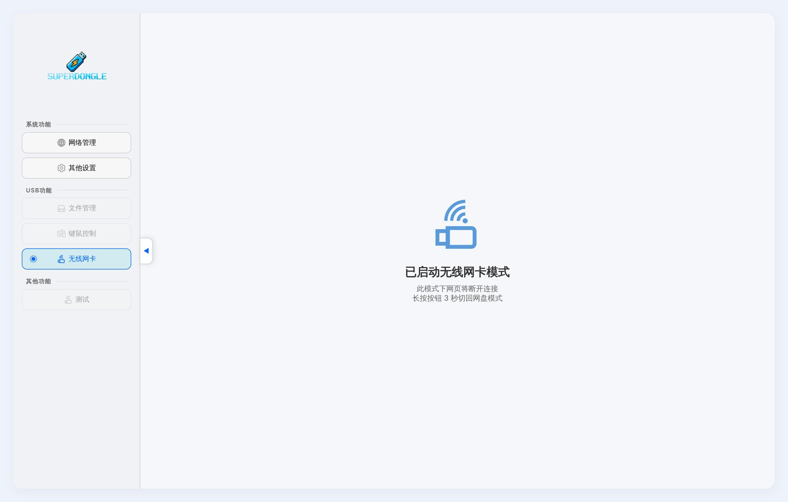<br><b>免驱 USB 网卡</b><br>NCM 模式下电脑通过它上 WiFi，实测约 1MB/s。</td>
<td>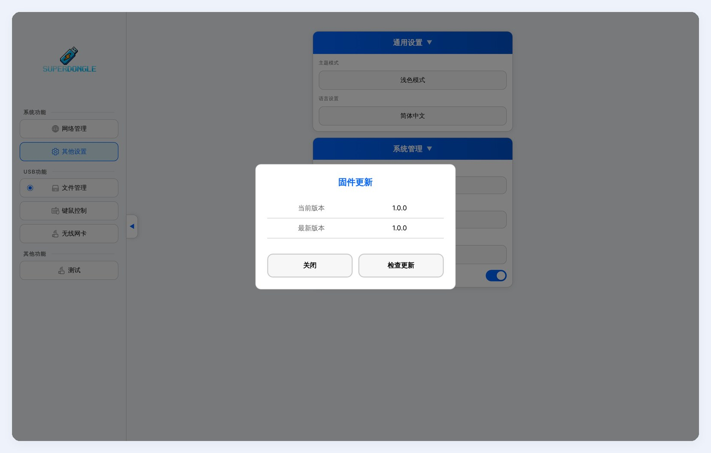<br><b>OTA 在线升级</b><br>网页里一键检查更新，固件和网页都是 A/B 双分区写入，失败也不会变砖。</td>
</tr>
</table>

---

## 快速上手

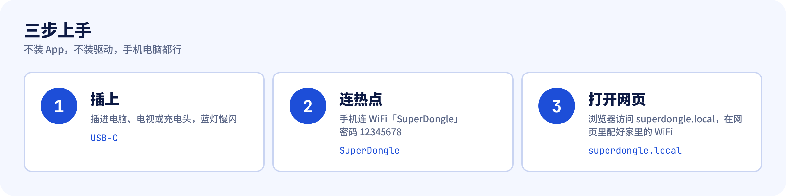

1. **插上**：把 SuperDongle 插到电脑、电视或充电头的 USB 口，指示灯蓝色慢闪。
2. **连热点**：手机连接 WiFi `SuperDongle`，默认密码 `12345678`。
3. **打开网页**：浏览器访问 `http://superdongle.local`，在网页里选择家里的 WiFi。连上后指示灯变绿常亮，之后在同一局域网里访问 `superdongle.local` 就行。

> [!WARNING]
> v1.0.0-beta 的网页还没有登录验证。请先修改默认热点密码，并只在自己信任的网络里使用。后续版本会加入访问密码。

---

## 使用场景

<table>
<tr>
<td width="33%">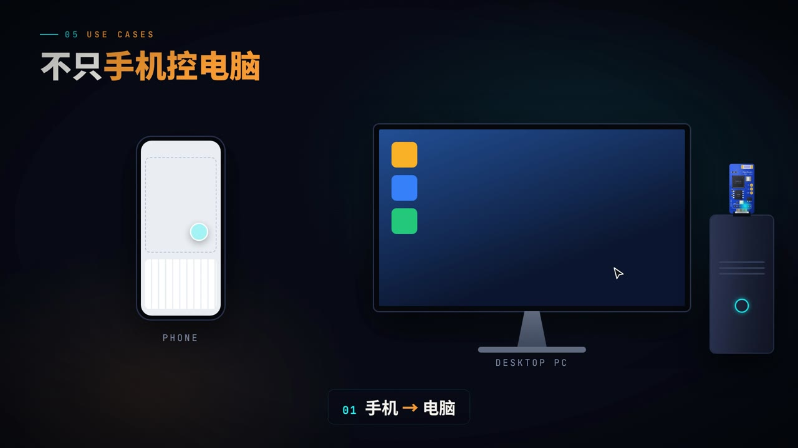<br>插在台式机上，当 U 盘和无线中转站</td>
<td width="33%">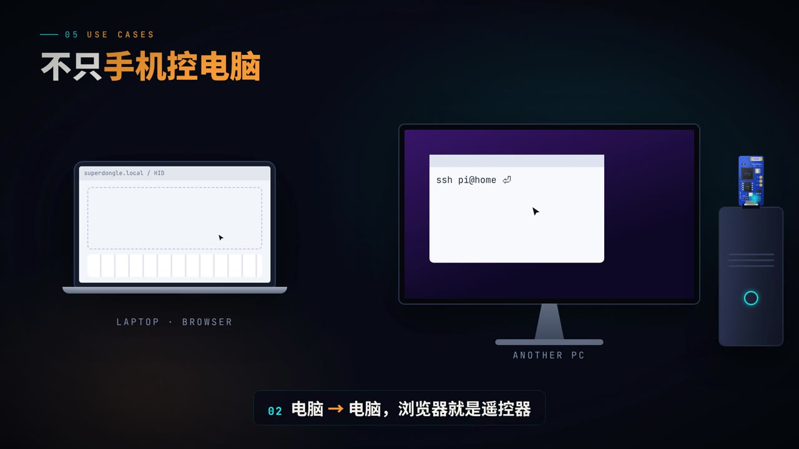<br>手机隔空控制电脑，放 PPT、点视频</td>
<td width="33%">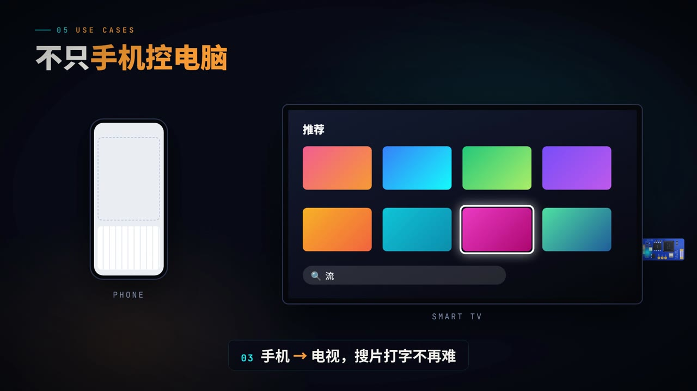<br>插在电视侧面，手机传片直接播</td>
</tr>
</table>

---

## USB 模式

同一时间只工作在一种模式，切换时 USB 会重新枚举，电脑上会看到设备断开又连上。

| 模式 | 电脑识别为 | 适合做什么 |
| --- | --- | --- |
| **MSC** U 盘 | 大容量存储设备 | 有线拷文件（约 1MB/s），同时手机可以无线管理 TF 卡 |
| **HID** 键鼠 | USB 键盘 + 鼠标 | 手机当触控板和键盘，远程控制电脑 |
| **NCM** 网卡 | USB 网卡（免驱） | 没有无线网卡的电脑，通过它连 WiFi 上网 |

<table>
<tr>
<td width="50%">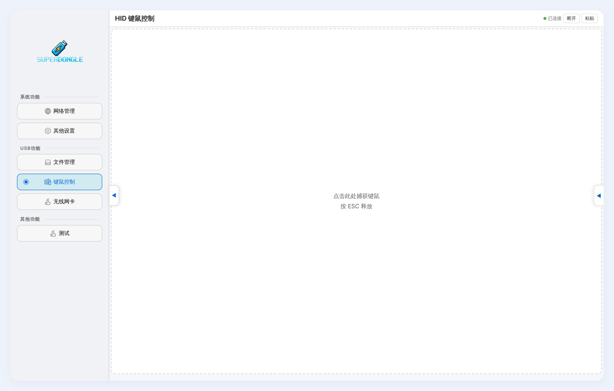<br><b>网页切换</b><br>侧栏点「文件管理 / 键鼠控制 / 无线网卡」，就会切到对应的 USB 模式。</td>
<td width="50%">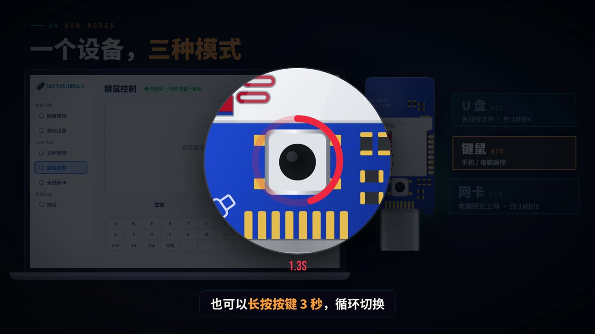<br><b>按键切换</b><br>长按板子背面的按键 3 秒，循环切换。网页打不开的时候用它。</td>
</tr>
</table>

---

## 指示灯

板载一颗 WS2812 全彩灯，一眼看出设备在做什么。

| 颜色 | 状态 |
| --- | --- |
| 🔵 蓝色慢闪 | 等待配网（热点模式） |
| 🟢 绿色慢闪 | 正在连接 WiFi |
| 🟢 绿色常亮 | 已连接 WiFi |
| ⚪ 白色快闪 | 正在传输文件 |
| 🟣 紫色快闪 | 正在升级固件 |
| 🔴 红色常亮 | WiFi 连接失败 |
| 🔴 红色闪 2 秒 | 文件传输或升级出错，之后自动恢复 |

---

## 硬件

<div align="center">
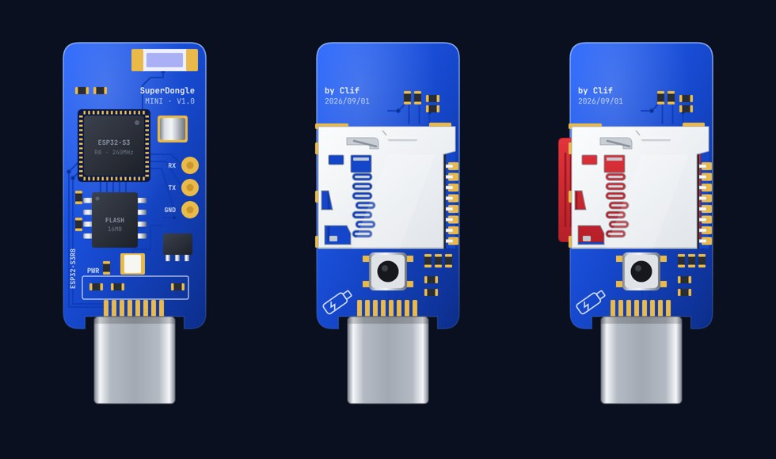
<sub>正面 · 背面 · 插入 microSD 卡</sub>
</div>

<br>

<table>
<tr>
<td width="50%" align="center">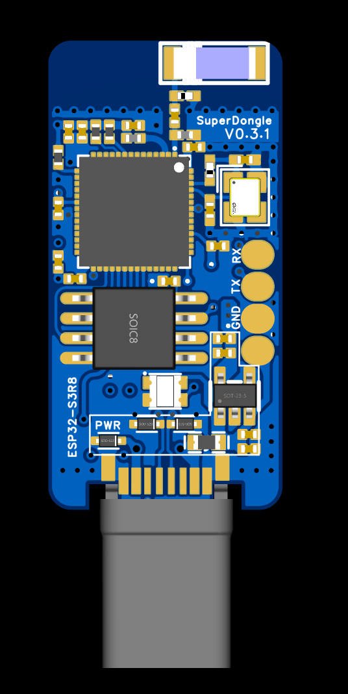</td>
<td width="50%" align="center">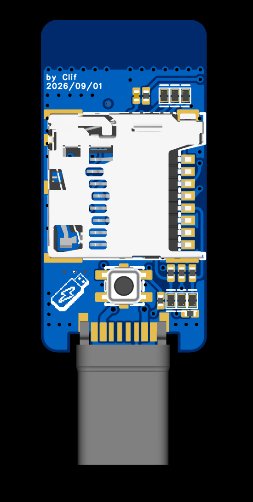</td>
</tr>
<tr>
<td align="center"><sub>立创 EDA 3D 预览 · 正面</sub></td>
<td align="center"><sub>立创 EDA 3D 预览 · 背面</sub></td>
</tr>
</table>

### 规格

<table>
<tr>
<td width="50%">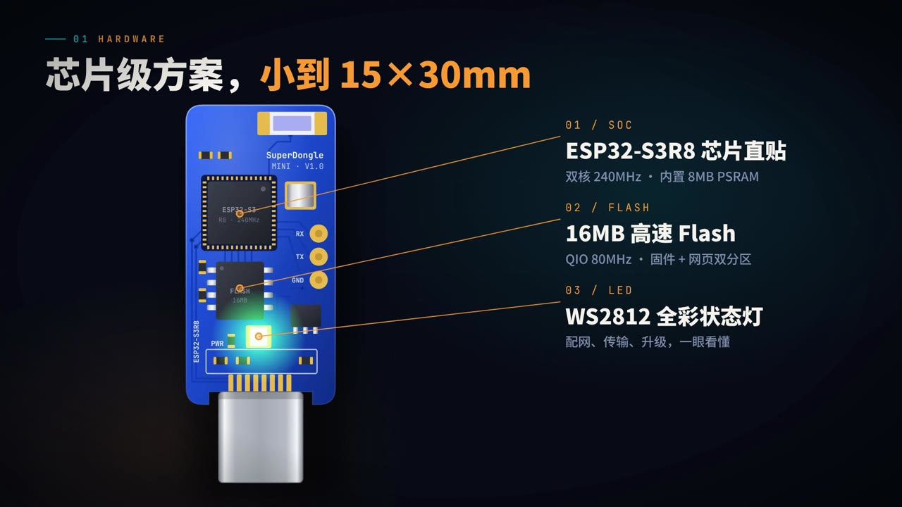</td>
<td width="50%">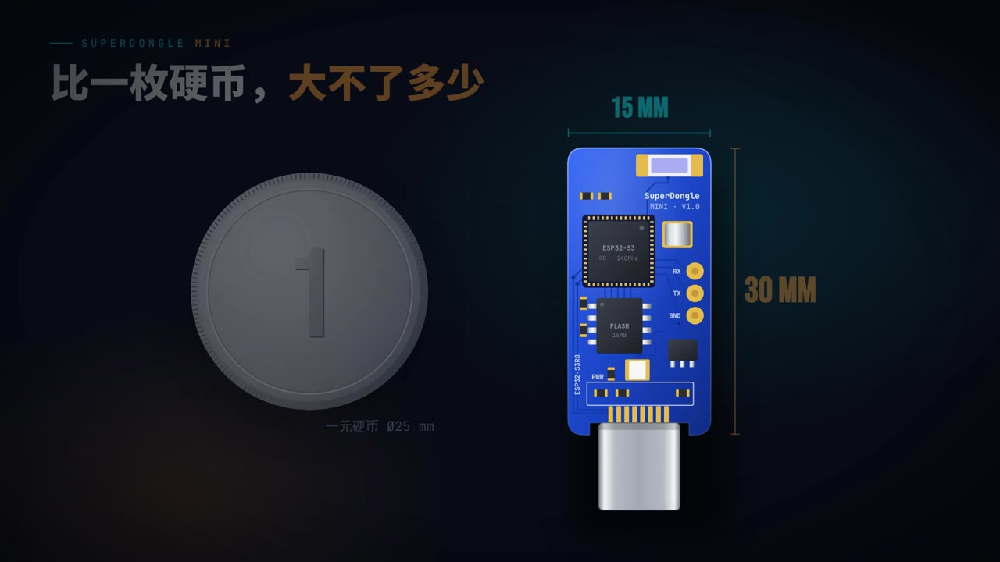</td>
</tr>
<tr>
<td align="center"><sub>主要器件</sub></td>
<td align="center"><sub>大约一枚 1 元硬币的宽度</sub></td>
</tr>
</table>

| 项目 | 规格 |
| --- | --- |
| 尺寸 | 15 × 30 mm（不含 USB-C 插头） |
| 主控 | ESP32-S3R8，Xtensa LX7 双核 240MHz |
| 内存 | 8MB Octal PSRAM（芯片内置） |
| Flash | 16MB，QIO 80MHz |
| 无线 | WiFi 2.4GHz + BLE 5，板载陶瓷天线 |
| 存储 | microSD（TF）卡槽，SDMMC 4-bit |
| 传输速度 | 有线 U 盘约 1MB/s，无线文件传输最高 4MB/s，网卡模式约 1MB/s |
| 接口 | USB-C 公头直插，USB 2.0 Full-Speed |
| 供电 | USB 5V → ME6217C33 LDO → 3.3V（800mA） |
| 保护 | PTC 自恢复保险丝，USB 数据线和 VBUS 带 ESD，TF 卡信号线带 ESD |
| 指示灯 | WS2812B-2020 全彩灯 |
| 按键 | 1 个，兼 BOOT 键 |
| 调试 | RX / TX / GND 串口焊盘 |
| 设计工具 | 立创 EDA |

### 硬件框图

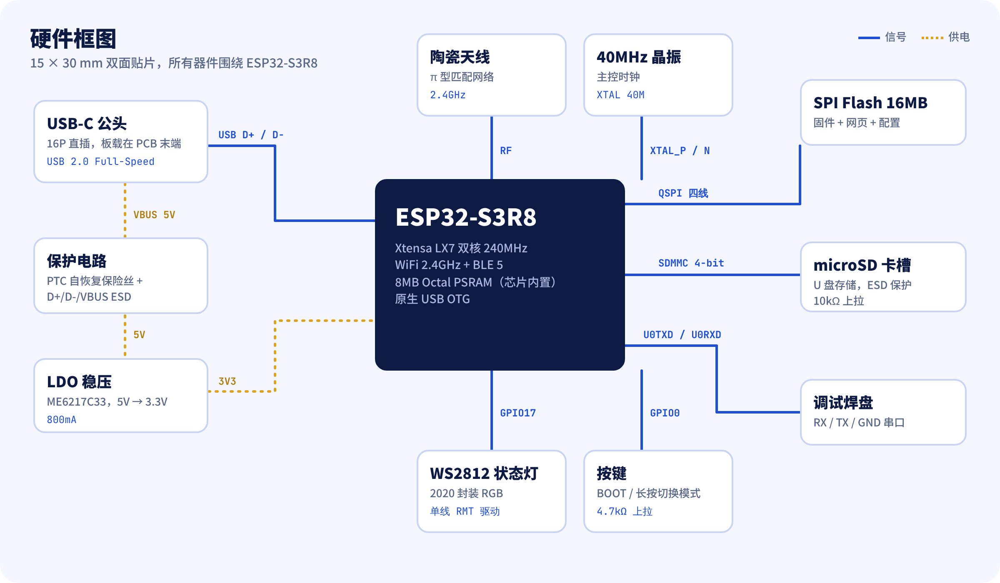

### 原理图

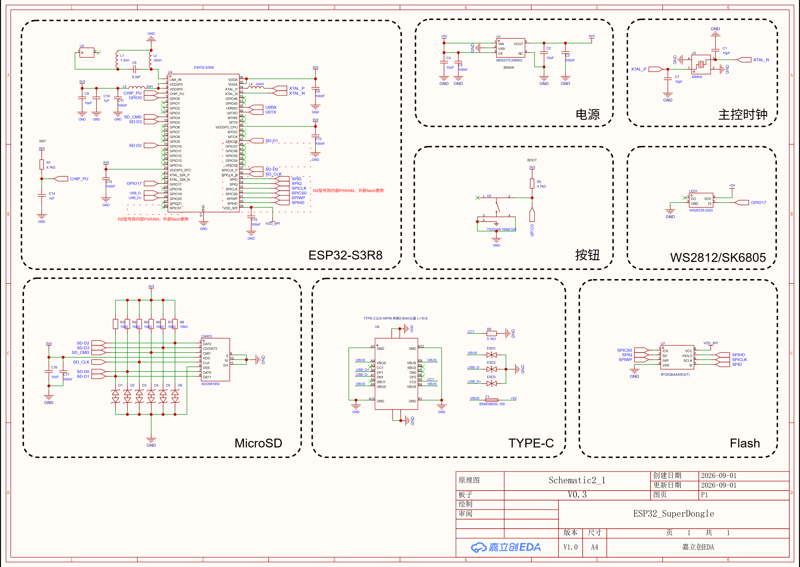

<details>
<summary><b>按模块查看原理图（点开）</b></summary>

<br>

| 模块 | 原理图 | 说明 |
| --- | --- | --- |
| 主控 | 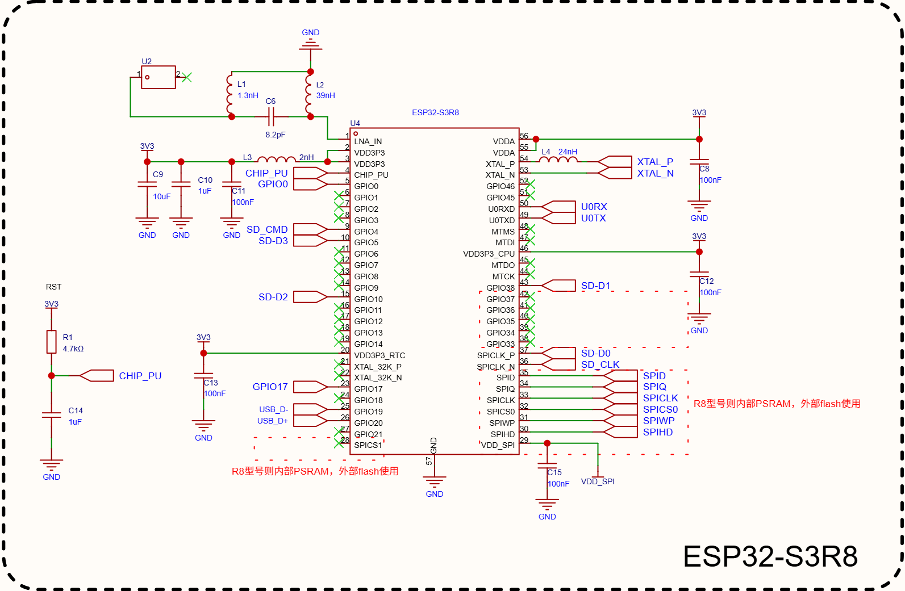 | ESP32-S3R8，天线 π 型匹配网络，USB D+/D- 直连 GPIO19/20 |
| 电源 | 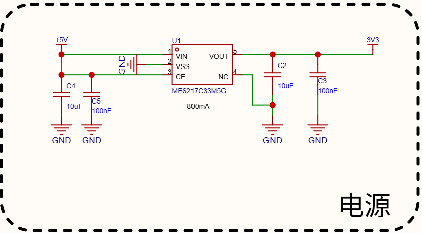 | ME6217C33 LDO，5V 转 3.3V |
| 主控时钟 | 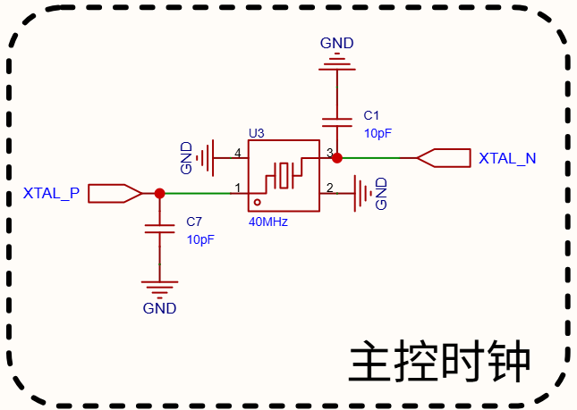 | 40MHz 无源晶振 |
| 按键 | 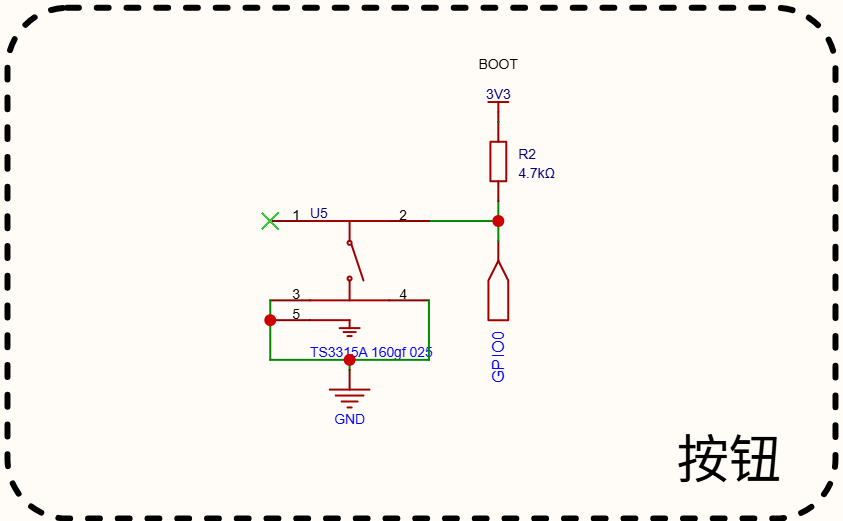 | 接 GPIO0，4.7kΩ 上拉，按住上电进下载模式 |
| 状态灯 | 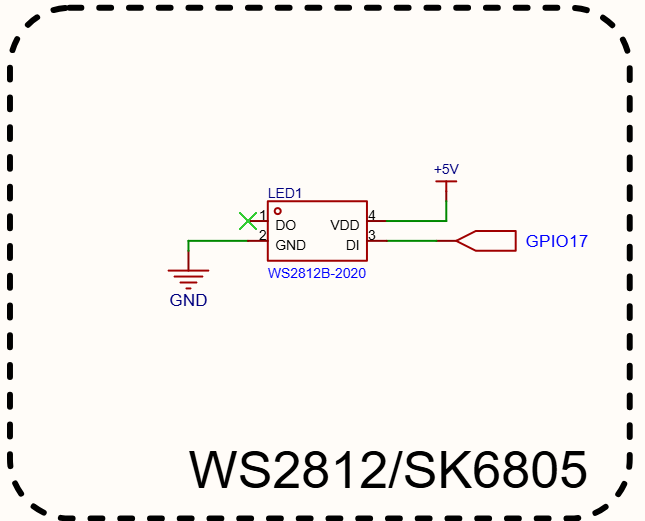 | WS2812B-2020，数据线接 GPIO17 |
| microSD | 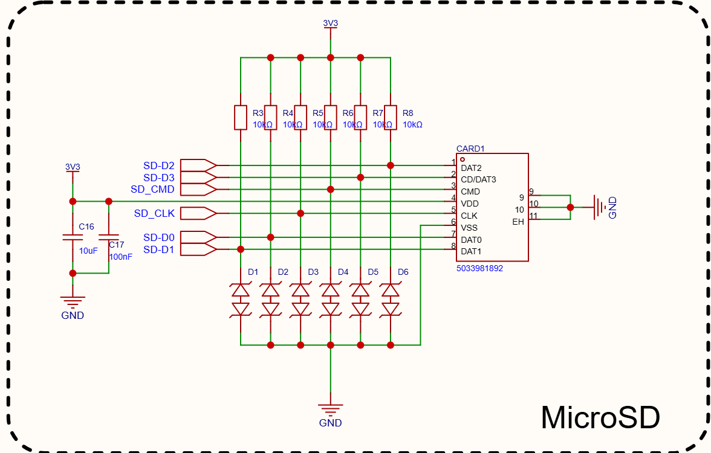 | 4-bit SDMMC，10kΩ 上拉，每根信号线一颗 ESD |
| USB-C | 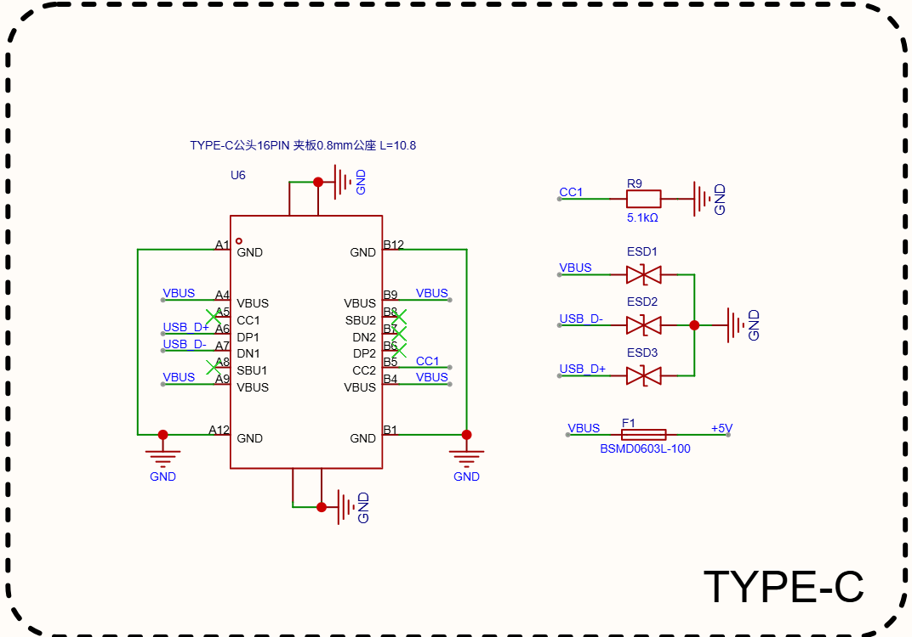 | 16P 公头，CC 5.1kΩ 下拉，ESD + 自恢复保险丝 |
| Flash | 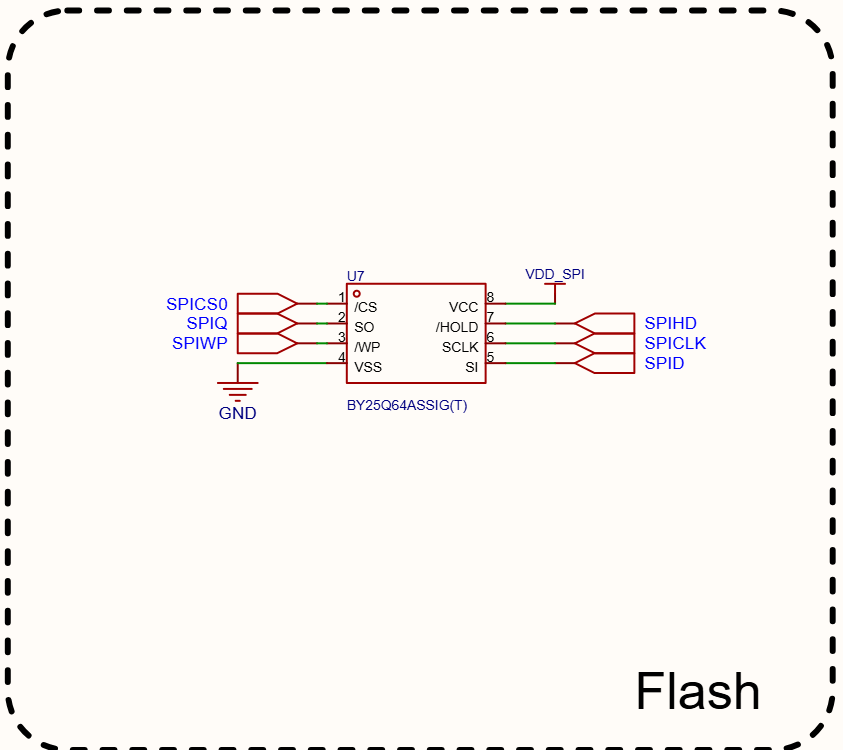 | 外置 QSPI Flash |

</details>

### 引脚分配

| 功能 | GPIO | 备注 |
| --- | --- | --- |
| USB D- | GPIO19 | 原生 USB OTG |
| USB D+ | GPIO20 | 原生 USB OTG |
| SD CLK | GPIO48 | |
| SD CMD | GPIO4 | |
| SD D0 | GPIO47 | |
| SD D1 | GPIO38 | |
| SD D2 | GPIO10 | |
| SD D3 | GPIO5 | |
| WS2812 | GPIO17 | RMT 驱动 |
| 按键 | GPIO0 | BOOT，低电平有效 |
| 串口 TX / RX | U0TXD / U0RXD | 调试焊盘，115200 |

> SD 卡和状态灯的引脚可以在 `idf.py menuconfig` → SuperDongle Hardware Configuration 里改，方便移植到别的 ESP32-S3 板子。

### PCB

<table>
<tr>
<td width="40%" align="center">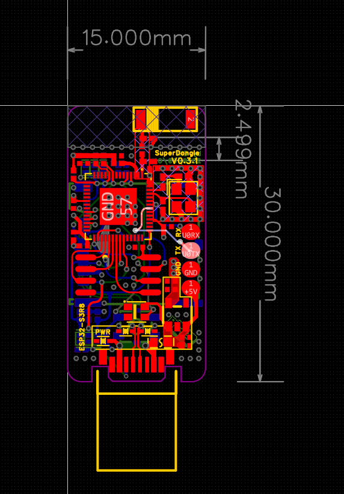</td>
<td width="60%">

- 板子尺寸 **15 × 30 mm**，USB-C 公头直接焊在板子末端，插上就用，不需要线。
- 正面放主控、Flash、晶振、LDO 和状态灯，背面放 microSD 卡槽和按键。
- 天线放在远离 USB 口的一端。
- 用立创 EDA 设计，工程文件放在 `hardware/` 目录。

</td>
</tr>
</table>

---

## 固件架构

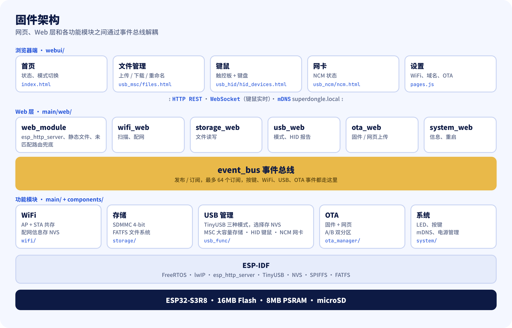

- **网页在设备里**：前端页面放在 SPIFFS 分区，浏览器打开 `superdongle.local` 就能用，不用装任何软件。
- **事件总线**：按键、WiFi、USB、OTA 的状态变化都发到 `event_bus`，各模块按需订阅，加新功能不用改已有模块。
- **模式记忆**：选好的 USB 模式存进 NVS，下次上电还是这个模式。
- **键鼠两条通道**：网页键鼠走 WebSocket 实时发送；另外监听 UDP 8888 端口，电脑上的 Python 脚本也能发键鼠事件。

### 目录结构

```text
super-dongle-firmware/
├── main/
│   ├── entry/          # app_main，启动顺序
│   ├── wifi/           # AP + STA，配网信息存 NVS
│   ├── storage/        # SDMMC + FATFS
│   ├── usb_func/       # TinyUSB：MSC / HID / NCM，模式管理
│   ├── web/            # HTTP 服务和各个接口
│   │   └── web_handlers/   # wifi / storage / usb / ota / system
│   └── system/         # LED 指示、按键、mDNS
├── components/
│   ├── event_bus/      # 事件总线
│   ├── ota_manager/    # 固件 + 网页 OTA
│   ├── esp_tinyusb/    # TinyUSB 封装
│   ├── led_strip/      # WS2812 驱动
│   └── mdns/           # superdongle.local
├── webui/              # 网页前端（首页、文件、键鼠、网卡）
├── tools/
│   ├── flash_tools/    # 图形化烧录工具
│   ├── build_spiffs/   # 网页打包
│   └── ota_server_local/  # 局域网 OTA 服务器
├── docs/               # 快速上手、前端接口、安全设计
├── partitions.csv
└── sdkconfig.defaults
```

### Flash 分区与 OTA

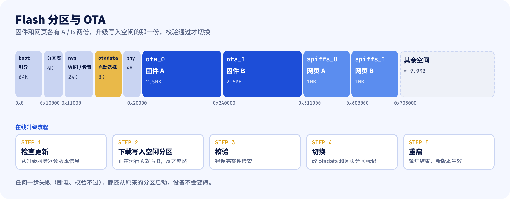

| 分区 | 大小 | 用途 |
| --- | --- | --- |
| nvs | 24KB | WiFi 配置、设置项 |
| otadata | 8KB | 记录从哪个固件分区启动 |
| ota_0 / ota_1 | 2500KB × 2 | 固件 A / B |
| spiffs_0 / spiffs_1 | 1000KB × 2 | 网页 A / B |

<table>
<tr>
<td width="50%"></td>
<td width="50%">

在网页「其他设置 → 系统管理」里点固件版本，打开「固件更新」，再点「检查更新」。设备会从升级服务器读版本信息，有新版本就自动下载固件和网页。

全部写完并校验通过后才切换启动分区，中途断电或校验失败，下次开机还是原来的版本。

自己编译的固件，可以用 `tools/ota_server_local/ota_server.py` 在电脑上开一个局域网升级服务器，把地址填进网页的 OTA 服务器设置里。

</td>
</tr>
</table>

---

## 编译烧录

### 环境

- [ESP-IDF](https://docs.espressif.com/projects/esp-idf/zh_CN/latest/esp32s3/get-started/) 5.x
- Python 3（打包网页、烧录工具用）

### 编译

```bash
git clone <本仓库地址>
cd SuperDongle
idf.py set-target esp32s3
idf.py build
```

### 第一次烧录

1. 按住板子背面的按键，再插到电脑上，进入下载模式。
2. 烧录并打开串口日志：

```bash
idf.py -p <端口> flash monitor
```

不想用命令行的话，可以用 `tools/flash_tools/flash_tool_gui.py` 图形化烧录，它会按 `partitions.csv` 自动算出各分区地址。

### 之后的更新

用 `tools/ota_server_local/ota_server.py` 在电脑上开局域网升级服务器，把 `build/` 下生成的固件和网页放上去，在网页里点「检查更新」，不用再插线烧录。

---

## 常见问题

<details>
<summary><b>打不开 superdongle.local？</b></summary>

部分安卓手机和老版本 Windows 不支持 mDNS 域名。可以在路由器后台查 SuperDongle 的 IP 直接访问，或者连设备热点后在网页「网络管理」页查看地址。
</details>

<details>
<summary><b>切到网卡模式后网页打不开了？</b></summary>

NCM 模式下电脑和设备之间多了一条网络，换个设备（比如手机）访问网页，或者长按按键 3 秒切回 U 盘模式。
</details>

<details>
<summary><b>各种模式速度多少？</b></summary>

- 有线 U 盘：约 1MB/s，适合拷文档、图片这类小文件。
- 无线文件传输：最高 4MB/s，大文件建议走网页上传下载。
- 网卡模式：大约 1MB/s，看视频、浏览网页够用。下图是网卡模式下的一次实测。

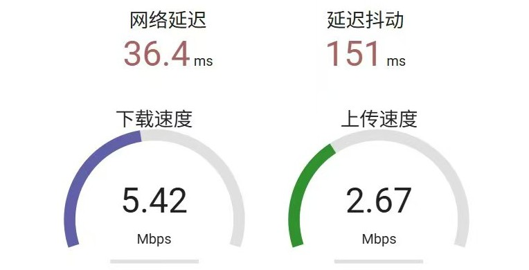
</details>

<details>
<summary><b>升级失败会变砖吗？</b></summary>

不会。固件和网页都是 A/B 双分区，校验通过才切换。实在启动不了，按住按键插电进下载模式重新烧录即可。
</details>

---

## 路线图

- [x] U 盘 + 无线文件管理
- [x] WiFi 配网 + mDNS 域名
- [x] 手机当键鼠（HID）
- [x] 免驱 USB 网卡（NCM）
- [x] 固件 + 网页 OTA
- [ ] 网页登录密码
- [ ] 网页插件扩展
- [ ] 更多玩法，欢迎提 idea

---

## 参与共建

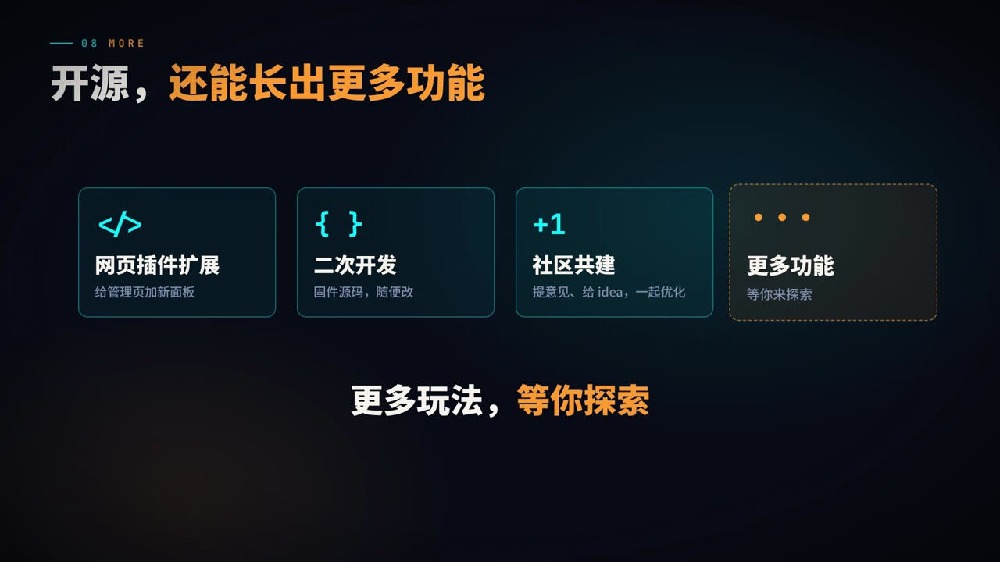

- **网页插件扩展**：在网页端加自己的小工具。
- **二次开发**：非商用的前提下，固件源码随便改，加功能、换外设都行。
- **社区共建**：遇到问题或有新想法，欢迎提 Issue 和 Pull Request，一起把它做好。
- **开发文档**：目录结构、协作规范见 [docs/开发说明.md](docs/开发说明.md)；REST 接口见 [docs/前端开发接口文档.md](docs/前端开发接口文档.md)。

---

## 致谢

- [ESP-IDF](https://github.com/espressif/esp-idf) · [TinyUSB](https://github.com/hathach/tinyusb) · [esp_tinyusb](https://github.com/espressif/esp-usb) · [espressif/mdns](https://github.com/espressif/esp-protocols) · [led_strip](https://github.com/espressif/idf-extra-components)
- [立创 EDA](https://lceda.cn) 提供 PCB 设计工具

---

## 开源协议

本项目的固件与硬件设计采用 [CC BY-NC-SA 4.0](LICENSE)（署名-非商业性使用-相同方式共享 4.0 国际）协议：

- **可以**：个人学习、研究、修改、二次开发，以及非商业目的的分享和转载。
- **需要**：注明出处（作者与本仓库地址）；基于本项目修改后再发布的，也要用相同协议开源。
- **不可以**：未经授权用于商业目的，包括售卖成品、套件、PCB，或集成到商业产品中。

**商业使用请先联系作者获取授权**（GitHub Issue 或 B 站私信）。

本仓库中以下第三方组件不受上述协议约束，仍按各自原协议使用（目录内附原 LICENSE）：

| 目录 | 来源 | 协议 |
| --- | --- | --- |
| `components/esp_tinyusb` | [espressif/esp-usb](https://github.com/espressif/esp-usb) | Apache-2.0 |
| `components/mdns` | [espressif/esp-protocols](https://github.com/espressif/esp-protocols) | Apache-2.0 |
| `components/led_strip` | [espressif/idf-extra-components](https://github.com/espressif/idf-extra-components) | Apache-2.0 |

编译时通过组件管理器下载的 ESP-IDF、TinyUSB 等依赖，同样按其原协议使用。

<div align="center">
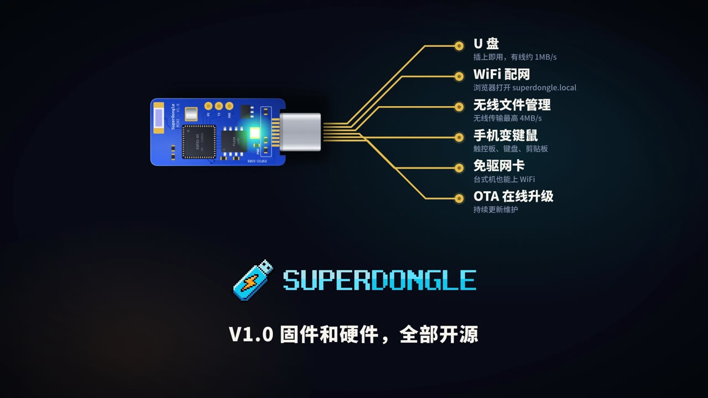

**插上它，剩下的交给浏览器。**
</div>
