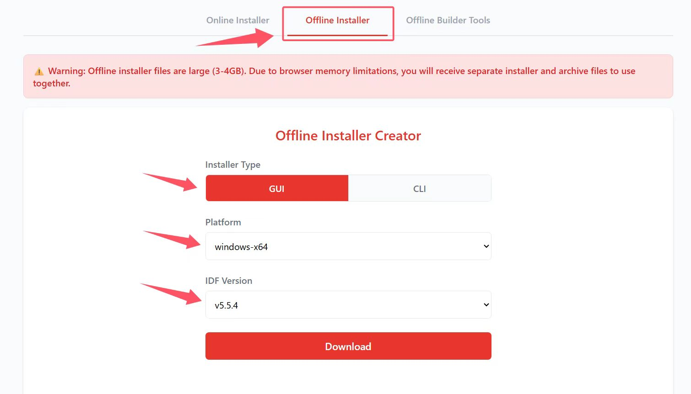

# SuperDongle 项目快速上手指南

---

## 1. 项目背景

SuperDongle 是一个基于 **ESP32-S3** 的多功能物联网硬件，插入电脑 USB 后会同时呈现为一个 **U 盘**（MSC 设备）和一个 **WiFi 热点**。用户可以通过手机/电脑浏览器访问 Web 管理页面，实现：

- **WiFi 配网**：扫描附近 WiFi，输入密码连接
- **文件管理**：通过网页浏览、上传、下载 SD 卡里的文件
- **OTA 升级**：通过 HTTP 远程更新固件和网页文件
- **USB 存储**：电脑上直接把 SD 卡当 U 盘用
- **HID 通信**：支持 HID 协议通信功能

### 核心参数

| 项目 | 值 |
|------|-----|
| 芯片 | ESP32-S3，双核 240MHz |
| Flash | 16MB，QIO 80MHz |
| PSRAM | 8MB，OCT 80MHz |
| 开发框架 | ESP-IDF 5.5.4 |
| 固件版本 | v1.0.0 |
| SD 卡接口 | SDMMC 4-bit（引脚见 BOARD 配置） |
| LED | WS2812 RGB（引脚见 BOARD 配置） |
| USB | TinyUSB 大容量存储类 |

---

## 2. 开发环境搭建

### 2.1 离线安装方式（推荐）

由于在线安装容易受网络影响，推荐使用离线安装包：

1. 访问离线安装包下载地址：[https://dl.espressif.cn/dl/eim/?tab=offline](https://dl.espressif.cn/dl/eim/?tab=offline)
2. 在页面中选择以下配置：
   - **Installer Type**：选择 `GUI`
   - **Platform**：选择 `windows-x64`
   - **IDF Version**：选择 `v5.5.4`
3. 点击 `Download` 按钮下载（文件约 1-4GB）



4. 下载完成后打开 VS Code，安装 `ESP-IDF Extension` 插件
5. 打开 **ESP-IDF 安装管理器**，选择离线环境，点击刚刚下载的离线包进行安装

> 具体安装步骤参考视频教程的离线安装部分：[https://b23.tv/8BFMkzf](https://b23.tv/8BFMkzf)

### 2.2 参考文档

ESP-IDF 官方 API 参考文档：[https://docs.espressif.com/projects/esp-idf/zh_CN/v5.5.4/esp32/api-reference/index.html](https://docs.espressif.com/projects/esp-idf/zh_CN/v5.5.4/esp32/api-reference/index.html)

ESP32-S3 技术参考手册：[https://documentation.espressif.com/esp32-s3_technical_reference_manual_cn.pdf](https://documentation.espressif.com/esp32-s3_technical_reference_manual_cn.pdf)

---

## 3. 快速构建项目

在 VS Code 中新建 ESP-IDF 工程，按以下步骤操作：

1. 将 `embeded` 文件夹下的所有文件复制到新建工程目录
2. 点击底部工具栏 ESP-IDF 插件图标，选择 `Select Port` 设置串口号
3. 选择 `Select Device`，选中 `ESP32-S3` 开发板
4. 选择 `SDK Configuration Editor`，确认开发环境版本为 5.5.4
5. 选择 `Build` 编译项目
6. 按住开发板 **BOOT** 按钮后通过 USB 上电，在 ESP-IDF 插件中选择 `Flash` 烧录（固件和 SPIFFS 网页文件会一起烧录，CMake 已配置好）

> 修改 `webui/` 下的网页文件后只需重新编译烧录即可，SPIFFS 会同步更新。

---

## 4. 项目结构

```
SuperDongle/
├── CMakeLists.txt             # 顶层构建文件
├── partitions.csv             # 分区表（OTA A/B + SPIFFS A/B）
├── sdkconfig.defaults         # 默认 SDK 配置
│
├── main/                      # 主项目代码（按功能分组）
│   ├── entry/                 # 程序入口
│   │   └── main.c
│   ├── system/                # 系统功能（按键、LED）
│   │   ├── button_manager.c/h
│   │   └── led_indicator.c/h
│   ├── wifi/                  # WiFi 管理
│   │   ├── wifi_manager.c/h
│   │   └── wifi_storage.c
│   ├── storage/               # 存储模块
│   │   └── storage_module.c/h
│   ├── web/                   # Web 服务
│   │   ├── web_module.c/h     # HTTP 服务器基础设施
│   │   └── web_handlers/      # 各业务模块 Web 路由（自动注册）
│   │       ├── wifi_web_handler/
│   │       ├── storage_web_handler/
│   │       ├── usb_web_handler/
│   │       ├── ota_web_handler/
│   │       └── system_web_handler/
│   └── usb_func/              # USB 功能模块
│       ├── usb_descriptors.c/h
│       ├── usb_hid_bridge.c/h
│       ├── usb_hid_receiver.c/h
│       ├── usb_manager.c/h
│       └── usb_msc.c/h
│
├── components/                # 组件
│   ├── esp_tinyusb/           # TinyUSB 协议栈
│   ├── event_bus/             # 事件总线（模块间解耦通信）
│   ├── led_strip/             # LED Strip 驱动
│   ├── mdns/                  # mDNS 协议栈
│   └── ota_manager/           # HTTP OTA 升级管理器
│
├── webui/                     # 前端网页（烧录到 SPIFFS）
│   ├── index.html
│   ├── files.html
│   ├── hid_devices.html
│   ├── app.js
│   └── index.css
│
├── tools/                     # 工具脚本
│   └── flash_tools/
│       └── flash_tool_gui.py
│
└── docs/                      # 文档
    ├── 前端开发接口文档.md     # REST API 接口规范
    └── 项目快速上手指南.md     # 项目上手教程
```

### 代码阅读顺序

建议按 `main.c → wifi_manager → web_module → web_handlers/* → storage_module → usb_func → led_indicator → ota_manager` 的顺序阅读。

---

## 5. 构建与烧录

在 VS Code 中打开项目文件夹，点击底部工具栏的 ESP-IDF 插件图标，选择 `Build` 编译。烧录时需要按住开发板 **BOOT** 按钮后通过 USB 上电，再选择 `Flash` 烧录。固件和 SPIFFS 网页文件会一起烧录，不需要分别操作。

---

## 6. 调试与日志

### 查看日志

烧录完成后，在 ESP-IDF 插件菜单中选择 `Monitor` 即可查看设备实时输出日志。按 `Ctrl+]` 退出。

设备启动后的关键日志顺序：

```
I (301) wifi_manager: WiFi manager started          ← WiFi 状态机启动
I (356) wifi_module: WiFi module init ok            ← WiFi 驱动初始化完成
I (412) wifi_module: Starting SoftAP...              ← AP 热点启动
I (478) web_module: HTTP server started on port 80  ← HTTP 服务器就绪
I (520) storage_module: SD card mounted              ← SD 卡挂载成功
I (580) usb_msc: MSC initialized                     ← USB 存储就绪
I (620) ota_mgr: OTA manager initialized             ← OTA 模块启动
```

如果日志停在上面的某一行不再继续，说明对应模块初始化失败，可据此快速定位问题。

### 验证 API

设备启动后，连接 `SuperDongle` 热点，在浏览器或命令行中测试接口：

```powershell
curl http://192.168.5.1/api/wifi/status
curl http://192.168.5.1/api/msc/status
curl http://192.168.5.1/api/ota/status
```

返回 JSON 格式数据，可判断各模块是否正常工作。

---

## 7. WiFi 管理场景

设备内置双模式 WiFi：通电后先开启 **AP 热点**（`SuperDongle`），用户连接后通过网页配网；配网成功后设备切换为 **STA 模式**连接路由器，同时关闭 AP 热点。

### 配网流程

1. 手机或电脑连接 WiFi `SuperDongle`（密码 `12345678`）
2. 浏览器访问 `http://192.168.5.1` 进入管理页面
3. 点击 **扫描 WiFi**，选择目标网络并输入密码
4. 设备连接路由器，成功后 LED 变绿，AP 热点自动关闭
5. 下次上电设备会自动连接已保存的 WiFi

### 管理已保存网络

设备可保存多个 WiFi 网络，启动时按优先级依次尝试连接：

- **查看已保存列表**：页面中查看已保存的 WiFi 名称和信号强度
- **手动连接已保存网络**：从列表中选择一个网络直接发起连接
- **删除已保存网络**：从列表中移除不需要的 WiFi
- **优先级排序**：最近成功连接的网络排在列表最前面

### 自动重连策略

设备连接断开后会自动重连，策略如下：

1. 按优先级依次遍历所有已保存的 WiFi 网络
2. 每个网络尝试连接，成功则停止
3. 全部失败后等待 10 秒，重新从头开始遍历
4. 持续失败时 LED 显示红色常亮

### LED 状态与 WiFi 的对应关系

| LED 状态 | 含义 |
|----------|------|
| 蓝色慢闪 | AP 热点模式，等待用户配网 |
| 绿色慢闪 | 正在连接路由器 |
| 绿色常亮 | WiFi 已成功连接 |
| 红色常亮 | 所有已保存 WiFi 均连接失败 |

---

## 8. 新增 Web API 模块

Web 路由采用 **constructor 自动注册** 模式，新增一个 Web handler 只需三步：

1. 在 `main/web/web_handlers/` 下新建文件夹，比如 `xxx_web_handler/`
2. 创建 `xxx_web_handler.c`，定义路由表 + init 函数 + constructor：

```c
static const web_route_t s_routes[] = {
    { "/api/xxx/action", HTTP_GET,  handler_xxx_action, NULL },
};

void xxx_web_handler_init(void) {
    web_module_register_routes(s_routes, ARRAY_SIZE(s_routes));
}

static void __attribute__((constructor, used)) xxx_auto_init(void) {
    web_module_register_handler("xxx", xxx_web_handler_init);
}
```

3. 创建 `xxx_web_handler.h`（如有需要可外部引用）

**不需要修改 `web_module.c`**，所有注册由 constructor 自动完成。

---

## 9. 常见问题

| 问题 | 解决 |
|------|------|
| 烧录后串口无输出 | 按住 BOOT + 按 RESET 进下载模式；检查 COM 口是否正确 |
| `build` 报错 | 在 ESP-IDF 插件菜单中选择 `Full Clean` 后重新构建 |
| USB 不显示 U 盘 | 确认 SD 卡已格式化（FAT32）；检查日志中有无 `sdmmc_card_init` 成功 |
| 浏览器无法访问 | 连接 `SuperDongle` 热点（密码 `12345678`），访问 `http://192.168.5.1` 或 `http://superdongle.local`（mDNS） |
| SPIFFS 网页没更新 | 重新编译烧录即可，固件和 SPIFFS 会一起更新；也支持独立网页 OTA |
| WiFi 连接不上 | ESP32-S3 仅支持 2.4GHz；确认密码正确 |
| 烧录失败提示超时 | 按住 BOOT 按钮重新上电，再点击烧录 |
| 网页显示乱码或样式错乱 | 检查 `webui/` 文件编码是否为 UTF-8；清除浏览器缓存重新加载 |
| 前端修改不生效 | `webui/` 中的文件修改后需要重新 Build + Flash，仅保存文件不够 |
| OTA 升级失败 | 检查 version.json 服务器地址和网络连通性；确认分区有足够空间 |

---